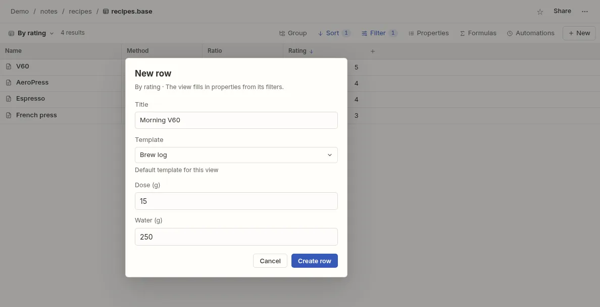

#  Kandinsky

Kandinsky is a workspace for Markdown notes, tasks, PDFs, and tables. Your **vault** is the folder that holds those files.

[Download for Windows (x64)](https://github.com/antimajorana/kandinsky/releases/latest) · [First-run guide](docs/guides/FIRST-RUN.md)

Run the installer, then choose **New vault…** or **Open a folder…**. You can open an existing Obsidian vault directly.

## The missing socks casebook

One striped sock vanished in the wash. Create a note called **Missing Socks** and type `[[Striped Sock]]` to link to its case. Give each case a `type` of `Sock case` and a `status`.

A **Base** shows matching notes as a table, board, or calendar. Press **F1**, search for **Bases**, and create `sock-cases.base`. Filter by type, sort by status, and embed the table in **Missing Socks** with `![[sock-cases.base]]`.

<picture>
  <source media="(prefers-color-scheme: dark)" srcset="docs/img/readme/workspace-dark.webp">
  
</picture>

When another sock goes missing, select **New** in the Base. The example **Sock report** template asks for its color and where it was last seen. The answers are saved in a Markdown note that appears in the table. [Notes and templates](docs/guides/NOTES-SYSTEM.md#notes-from-templates)

<picture>
  <source media="(prefers-color-scheme: dark)" srcset="docs/img/readme/base-template-dark.webp">
  
</picture>

## Build from source

For local development, use Rust stable and Node 24.

```sh
npm --prefix ui ci
bash scripts/dev/dev.sh /path/to/vault
```

[Documentation](docs/INDEX.md) · [Compatibility](docs/guides/COMPATIBILITY.md) · [Self-hosting](docs/guides/SERVER.md) · [Changelog](docs/CHANGELOG.md)

[AGPL-3.0-or-later](LICENSE) · [License notices](docs/THIRD-PARTY.md)
